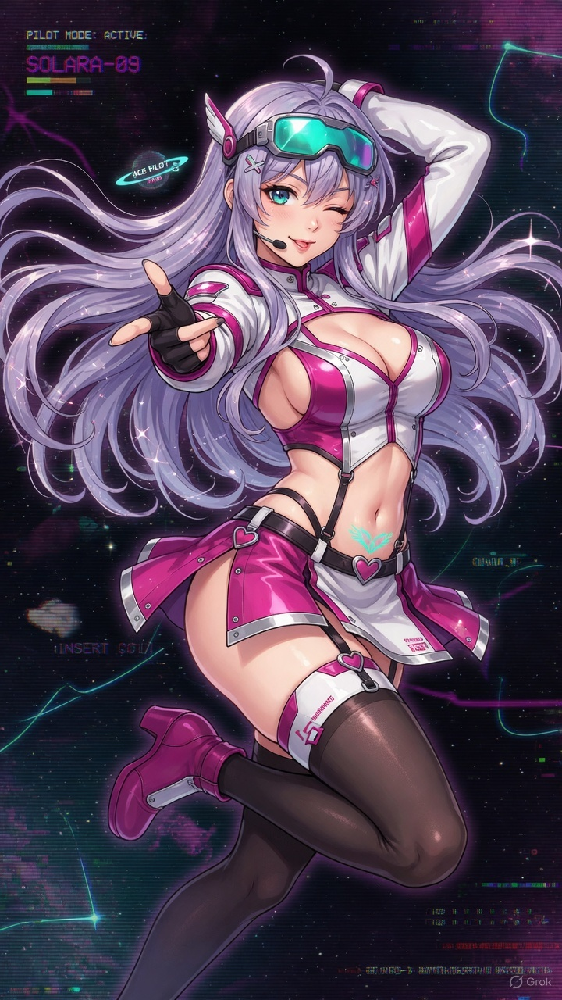

# Lumina Veil: Sideway Stars

<p align="center">
  
</p>

<p align="center">
  <b>A retro 2D side-scrolling space shooter with 16-bit arcade aesthetics, ecchi anime character art, multi-layer parallax space nebulae, modular weapons, and dynamic story cut-ins.</b>
</p>

<p align="center">
  <a href="LICENSE"></a>
  <a href="https://godotengine.org/"></a>
  <a href="https://github.com/everydayrandomshit5"></a>
  <a href="#-ai-transparency--disclosure"></a>
</p>

---

## 👨‍💻 Creator & Socials

- **Author**: **Random Guy**
- **GitHub**: [@everydayrandomshit5](https://github.com/everydayrandomshit5)
- **Instagram**: [@everyday_randomshit](https://www.instagram.com/everyday_randomshit/)

---

## 🎮 How to Play

### 🪟 Windows (Standalone - No Install Required)
Inside the `build/` folder:
- Double-click **`Play_Lumina_Veil.bat`** (or run `LuminaVeil.exe`).

### 🐧 Linux
- Run the Linux launcher script:
  ```bash
  chmod +x launch_game.sh
  ./launch_game.sh
  ```
  Or from the `build/` directory:
  ```bash
  chmod +x build/Play_Lumina_Veil.sh
  ./build/Play_Lumina_Veil.sh
  ```

---

## 🕹️ Controls

| Action | Key / Input |
|---|---|
| **Movement** | `W`, `A`, `S`, `D` or `Arrow Keys` (8-directional, left 60% screen) |
| **Primary Fire** | Hold `Spacebar` or `Left Mouse Button` |
| **Temptation Burst** | `Left Shift` or `Right Mouse Button` (When Charm Gauge reaches 100%) |
| **Pause Mission** | `Escape` or `P` |
| **Restart / Re-deploy** | `R` or `Spacebar` on Game Over screen |

---

## 🌟 Game Features

- **Lead Pilot — Aria Solara**: Original starfighter pilot with reactive in-cockpit HUD transmissions, natural anime blushing damage reactions, and full-screen anime battle cut-ins.
- **Rival Ace — Lyra Vex & Tactical Officer Selene**: Meet the Crimson Phantom rival and fleet bridge commander in the interactive Pilot Gallery.
- **4 Stackable Weapons**:
  1. *Pulse Laser*: High-velocity focused straight stream
  2. *Spread Shot*: Wide 3-to-5 projectile fan barrage
  3. *Piercing Beam*: Penetrating concentrated plasma lance
  4. *Homing Sparks*: Seeking electric sparks that track airborne hostiles
- **Charm Gauge & Temptation Burst**: Collect pink Lumina Orbs to charge the gauge to 100%, then trigger a screen-nuking energy wave that wipes bullets and melts enemies.
- **Boss Encounter — Drill Titan**: Massive industrial mining terror featuring rotating drill arms, plasma salvos, radial energy rings, and telegraphed charging attacks.
- **Retro CRT Shader**: Toggleable authentic 90s arcade CRT scanlines, chromatic aberration, and arcade vignette.
- **Interactive Pilot Gallery & Story CG Viewer**: Browse all character pinups and story event illustrations directly from the main menu.
- **16-bit Synthesized Chiptune Audio**: Retro laser blasts, explosions, pickups, and looping space synthwave soundtrack.

---

## 📂 Repository Structure

```
lumina-veil/
├── project.godot               # Godot 4 project configuration
├── launch_game.bat             # Windows 1-Click Game Launcher
├── launch_game.sh              # Linux Launcher Script
├── open_editor.bat             # 1-Click Godot 4 Editor Launcher
├── LICENSE                     # MIT License
├── README.md                   # Project Documentation
├── build/                      # Standalone Production Release
│   ├── LuminaVeil.exe          # Standalone Windows executable
│   ├── LuminaVeil.pck          # Compiled game package
│   ├── Play_Lumina_Veil.bat    # Windows release launcher
│   └── Play_Lumina_Veil.sh     # Linux release launcher
├── scenes/                     # Scene Trees (Title, Main, Player, Boss, HUD)
├── scripts/                    # GDScript Gameplay Systems
├── shaders/                    # CRT Scanline & Retro Bloom Shader
└── assets/
    ├── sprites/                # 16-bit pixel sprites & character art
    └── audio/                  # Synthesized 16-bit chiptune sound effects & BGM
```

---

## 🤖 AI Transparency & Disclosure

In the interest of full creative and technical transparency, this project was created using Generative AI assistance:
- **Game Architecture & Engine Code**: Built in Godot 4 (GDScript) with the pair-programming assistance of agentic AI coding tools (Google Antigravity).
- **Character Concept Art & Story CGs**: Generated with generative AI image tooling (Grok / xAI Imagine) based on original character specifications from the project Game Design Document.
- **Audio & SFX**: Procedural 16-bit retro chiptune audio synthesized with custom Python DSP scripts.
- **Creative Direction & Production**: Conceived, directed, iterated, and published by [Random Guy](https://github.com/everydayrandomshit5).

---

## 📜 License

Distributed under the **MIT License**. See [`LICENSE`](LICENSE) for details.
All character designs and concepts are original works by **Random Guy**.
